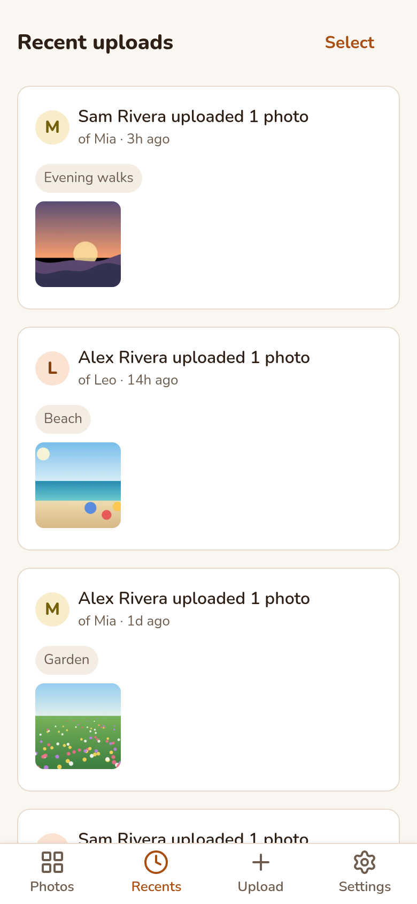
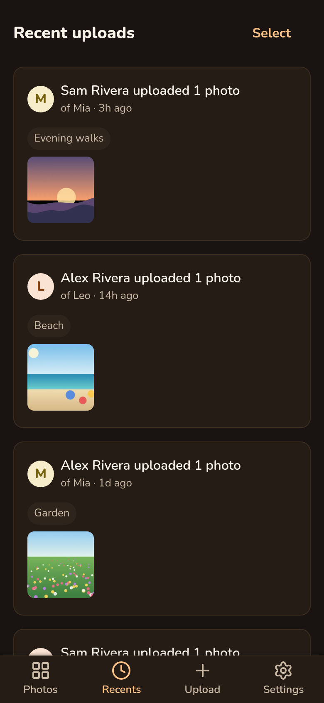
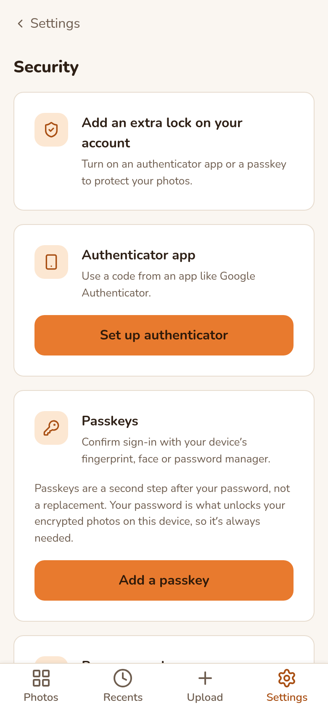
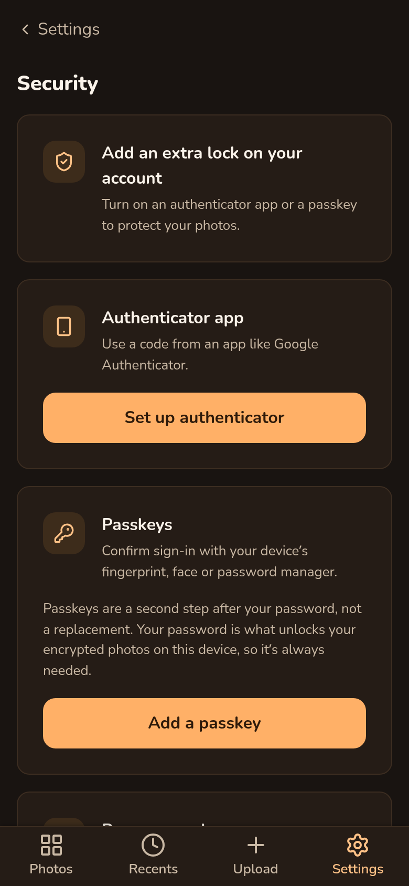

# Why Avapeek?

Avapeek does one job: sharing photos of your children with the people who should see them, without handing those photos to a company.

| | Social media | Shared albums | Avapeek |
| --- | --- | --- | --- |
| Built for | Reaching an audience | Your whole photo library | Kid photos for family |
| Provider can see your photos | Generally yes | Generally yes | No, they are encrypted |
| Business model | Ads and data | Storage subscription | None, open source |

Features and policies of other services change, so check their current terms.

## What you get

- **Encrypted in your browser.** Photos, EXIF data, tags and comments are encrypted before upload. See [how the encryption works](/security).
- **One family per child.** Invite relatives with a link. They see that child's photos and nothing else.
- **No ads, no tracking, no AI training.**
- **No lock-in.** Any member can download everything as a zip.
- **The nice parts.** A combined feed, tags, "On this day" memories, comments, an installable mobile app and optional two-factor login.

<figure><figcaption>Recent uploads</figcaption></figure>
<figure><figcaption>Optional two-factor</figcaption></figure>

## Trade-offs

- **No password reset.** A forgotten password cannot be recovered, though a relative can invite you again. See [password loss](/security#password-loss).
- **Fewer features** than big photo services: no face recognition, no automatic albums, no native app store app.
- **Self-hosting takes some effort.** You need a small server and look after updates and backups. A [hosted version](/hosted) is planned.
- **A young project** that has not been independently audited yet.

## Who it suits

Parents who want grandparents and relatives to see photos without a social network or a company in the middle, and anyone who wants a family archive they can keep for decades.

Ready? [Install it](/docs/installation) or read the [FAQ](/docs/faq).
